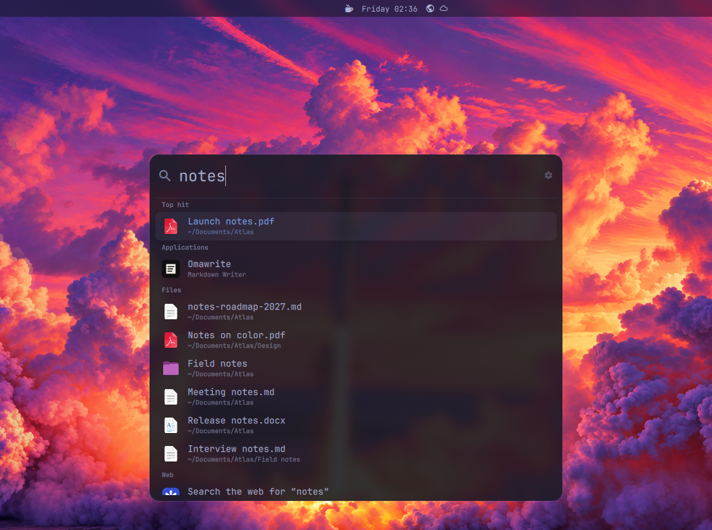
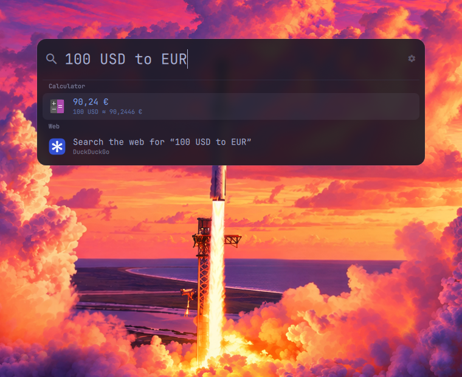
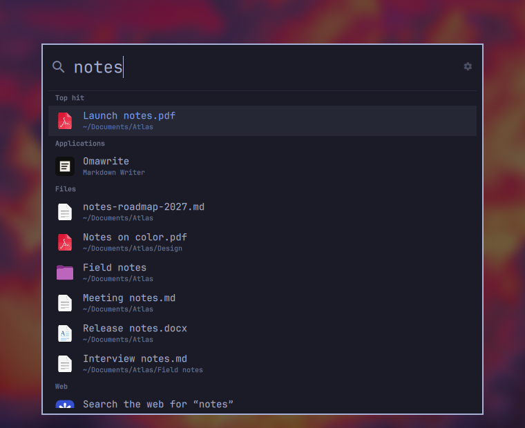
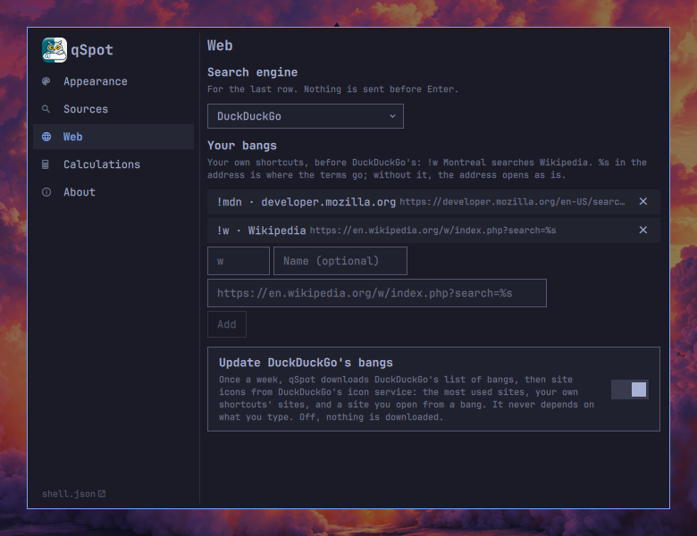

<p align="center">
  
</p>

<h1 align="center">qSpot</h1>

<p align="center">Une recherche façon Spotlight pour <a href="https://omarchy.org">Omarchy</a> : apps, fichiers, calculs et web dans un seul champ.</p>

<p align="center"><a href="README.md">English version</a></p>



**Vous venez de macOS ?** qSpot, c'est Spotlight : une touche, quelques lettres, Entrée.
Sous Windows : la recherche du menu Démarrer, ou PowerToys Run ; sous KDE : KRunner. Il va
de pair avec [qDock](https://github.com/quebecstudio-mods/omarchy-qdock), le Dock,
[qExposé](https://github.com/quebecstudio-mods/omarchy-qexpose), Exposé et Mission Control,
et [qCenter](https://github.com/quebecstudio-mods/omarchy-qcenter), le centre de notifications.

- **Les apps**, classées comme dans le menu d'Omarchy. Une app déjà ouverte
  s'affiche au lieu de se relancer ; Maj+Entrée ouvre une nouvelle fenêtre.
- **Les fichiers et dossiers** de votre dossier personnel, par leur nom, à
  mesure que vous tapez. qSpot tient son propre index, mis à jour toutes les
  demi-heures et à l'ouverture : un fichier enregistré il y a quelques minutes
  s'y trouve. Dépendances, caches et dossiers cachés restent dehors. Champ vide :
  les fichiers ouverts dernièrement.
- **Les fenêtres ouvertes**, trouvées par leur titre.
- **Calculs, unités et devises** : `12*7`, `5 km en mi`, `100 $ en €`,
  `15 % de 240`. Le résultat passe en tête ; Entrée le copie. Avec
  [qalc](https://qalculate.github.io) installé ; sans lui, l'arithmétique de base.
- **Le web.** Une adresse s'ouvre telle quelle. `!yt lofi` cherche sur YouTube :
  les 13 000 bangs de DuckDuckGo sont proposés pendant la frappe, et un bang
  suivi d'une espace devient une pastille avec l'icône du site. Ajoutez vos
  propres raccourcis ; la dernière ligne cherche sur le web avec le moteur de
  votre choix.
- **Il apprend.** Ce que vous ouvrez pour ce que vous tapez passe en tête la
  fois suivante, comme meilleur résultat. Gardé sur votre ordinateur seulement.
- **Rien de ce que vous tapez ne quitte votre ordinateur avant Entrée.**
- **Une fenêtre de réglages**, dessinée avec les contrôles d'Omarchy, et une
  loupe pour la barre.
- **Quatre styles**, ceux de qDock : Omarchy (le menu de votre thème), Cupertino
  (Spotlight, verre givré), Redmond (comme la recherche de Windows) et Plasma
  (KRunner, sous la barre). Si qDock est installé, qSpot prend son style, sauf
  si vous lui en donnez un.
- **Anglais et français**, selon la langue d'Omarchy. Les calculs lisent les
  mots français : `100 $ en €`, `15 % de 240`.

| Bangs | Calculs | Style Omarchy |
| --- | --- | --- |
|  |  |  |

## Installation

```bash
omarchy plugin add https://github.com/quebecstudio-mods/omarchy-qspot --enable
```

Omarchy affiche d'abord un avis de sécurité et demande de confirmer (*Clone and
add this plugin?*) ; ajoutez `--yes` pour passer la question dans un script.

La loupe s'ajoute à droite de la barre : un clic ouvre qSpot, un clic droit ses
réglages. Pour les calculs avec unités et devises, installez qalc :

```bash
omarchy pkg add libqalculate
```

### Une touche

La touche de Spotlight est Commande+Espace, qu'Omarchy donne à son menu
(Super+Espace). Alt+Espace, comme dans Raycast et PowerToys Run, sert à Omarchy
pour la dictée dès qu'une app de dictée est installée ; pour la donner à qSpot
(la dictée en maintenant Alt droite reste), ajoutez à `~/.config/hypr/bindings.lua` :

```lua
o.rebind("ALT + SPACE", "qSpot", "omarchy-shell -q quebecstudio.qspot toggle")
```

Ou laissez-y la dictée et prenez Super+Point, qui est libre :

```lua
o.bind("SUPER + PERIOD", "qSpot", "omarchy-shell -q quebecstudio.qspot toggle")
```

### Verre givré

Dans les styles Cupertino, Redmond et Plasma, la fenêtre est translucide. Pour
le flou derrière, ajoutez cette règle à `~/.config/hypr/hyprland.lua` :

```lua
hl.layer_rule({ match = { namespace = "^qspot$" }, blur = true, ignore_alpha = 0.2 })
```

## Désinstallation

```bash
omarchy plugin remove quebecstudio.qspot
```

Omarchy désactive qSpot, retire sa loupe de la barre et supprime son dossier.
Retirez ensuite ce que vous avez ajouté à la main : la touche dans
`~/.config/hypr/bindings.lua` (avec `o.rebind`, supprimer la ligne rend Alt+Espace
à la dictée), la règle de flou dans `~/.config/hypr/hyprland.lua` et, si vous
l'avez copiée, `~/.local/share/applications/qspot-settings.desktop`. Les
réglages de qSpot restent dans son entrée sous `plugins` dans
`~/.config/omarchy/shell.json`, et ce qu'il a appris ou mis en cache dans
`~/.local/state/qspot` et `~/.cache/qspot` : supprimez-les aussi pour repartir
de zéro.

## Touches

| Touche | Effet |
| --- | --- |
| Entrée | Ouvre le résultat choisi ; une app ouverte s'affiche ; un calcul est copié |
| Maj+Entrée | Une nouvelle fenêtre d'une app déjà ouverte |
| Ctrl+Entrée | Montre un fichier dans son dossier |
| Ctrl+C | Copie le chemin d'un fichier (sans texte sélectionné dans le champ) |
| ↑ ↓, Ctrl+P / Ctrl+N | Parcourent les résultats |
| Tab | Met le bang choisi dans la pastille |
| Retour arrière | Au début du champ, retire la pastille |
| Échap | Vide le champ, puis ferme qSpot |

## Réglages

qSpot a une fenêtre de réglages : cliquez sur l'engrenage au bout du champ,
faites un clic droit sur la loupe de la barre, ou ouvrez **Réglages de qSpot**
depuis le lanceur d'apps.



Pour la trouver aussi dans le menu d'Omarchy, ajoutez cette ligne à
`~/.config/omarchy/extensions/omarchy-menu.jsonc` :

```jsonc
"setup.qspot": {"icon":"󰍉","label":"Réglages de qSpot","aliases":["qspot","recherche","spotlight"],"action":"omarchy-shell -q quebecstudio.qspot settings"},
```

L'entrée du lanceur est dans le dossier `assets` du plugin :

```bash
cp ~/.config/omarchy/plugins/qspot/assets/qspot-settings.desktop ~/.local/share/applications/
cp ~/.config/omarchy/plugins/qspot/assets/logo.png ~/.local/share/icons/hicolor/256x256/apps/qspot.png
```

Chaque réglage est gardé dans l'entrée de qSpot sous `plugins` dans
`~/.config/omarchy/shell.json` (le lien **shell.json** en bas de la fenêtre
l'ouvre) :

```json
{
  "id": "quebecstudio.qspot",
  "style": "cupertino",
  "searchEngine": "kagi",
  "webShortcuts": {
    "w": "https://fr.wikipedia.org/w/index.php?search=%s",
    "local": { "name": "Sites locaux", "url": "http://%s.localhost", "home": "http://localhost" }
  }
}
```

| Réglage | Valeurs | Par défaut |
| --- | --- | --- |
| `style` | `"omarchy"`, `"cupertino"`, `"redmond"`, `"plasma"` | le style de qDock, sinon `"cupertino"` |
| `scrim` | `true` assombrit l'écran derrière qSpot, `false` le laisse tel quel | selon le style : oui pour Omarchy et Redmond, non pour Cupertino et Plasma |
| `apps` | `false` laisse les apps de côté | `true` |
| `windows` | `false` : les apps ouvertes se relancent au lieu de s'afficher, et les fenêtres ne sont pas cherchées | `true` |
| `files` | `false` laisse les fichiers de côté | `true` |
| `recentFiles` | `false` : rien tant que le champ est vide | `true` |
| `calculations` | `false` laisse les calculs de côté | `true` |
| `web` | `false` laisse de côté les adresses et la ligne de recherche sur le web ; les bangs marchent toujours | `true` |
| `searchEngine` | `"duckduckgo"`, `"google"`, `"bing"`, `"kagi"`, `"startpage"`, `"ecosia"`, `"brave"`, `"qwant"`, ou une adresse avec `%s` à la place des mots | `"duckduckgo"` |
| `webShortcuts` | Vos propres bangs, avant ceux de DuckDuckGo : `{ "déclencheur": "adresse avec %s" }`, ou `{ "déclencheur": { "name", "url", "home" } }` (voir plus bas) | aucun |
| `learn` | `false` : qSpot ne retient pas vos choix | `true` |
| `bangUpdates` | `false` : ni les bangs de DuckDuckGo ni les icônes de sites ne sont téléchargés | `true` |
| `currencyUpdates` | `false` : les taux de change de qalc ne sont pas mis à jour | `true` |

### Vos propres raccourcis

Le déclencheur d'un raccourci se tape après `!`, en majuscules ou non. `%s`
dans l'adresse marque où vont les mots ; sans lui, l'adresse s'ouvre telle
quelle. `!w Montréal` cherche dans Wikipédia ; `!w` seul ouvre le site. Quand
`%s` fait partie du site lui-même (`http://%s.localhost`), donnez un `home`
pour le bang tapé seul. Les raccourcis s'ajoutent et se retirent dans la
fenêtre de réglages, sous Web.

## Commandes

```bash
omarchy-shell -q quebecstudio.qspot toggle
omarchy-shell -q quebecstudio.qspot open "texte"   # ouvre avec le champ rempli, pour un dock ou un menu Démarrer
omarchy-shell -q quebecstudio.qspot close
omarchy-shell -q quebecstudio.qspot settings      # la fenêtre de réglages
omarchy-shell -q quebecstudio.qspot settingsAt web   # sur une section : appearance, sources, web, calc, about
omarchy-shell -q quebecstudio.qspot about
```

## Vie privée

Ce que vous tapez reste sur votre ordinateur jusqu'à Entrée, puis ne va qu'au
site choisi. qSpot lui-même se connecte au réseau pour trois choses, dont
aucune ne dépend de ce que vous tapez :

- **La liste des bangs de DuckDuckGo**, depuis `duckduckgo.com/bang.js`, une
  fois par semaine à l'ouverture.
- **Des icônes de sites**, par le service d'icônes de DuckDuckGo : celles des
  300 bangs les plus utilisés et des sites de vos raccourcis à l'avance, et
  celle d'un autre site une fois que vous l'avez ouvert par un bang.
  `bangUpdates: false` coupe les deux.
- **Les taux de change**, que qalc télécharge au plus une fois par jour à
  l'ouverture. `currencyUpdates: false` coupe cela.

L'index de vos fichiers (`~/.cache/qspot/home.db`) et ce que qSpot apprend
(`~/.local/state/qspot/choices.json`) restent sur votre ordinateur ; **Oublier
mes choix**, sous Sources, efface ce dernier.

## Bon à savoir

- qSpot a besoin de `plocate` et de Python, tous deux fournis avec Omarchy.
  Tant que son index n'est pas prêt, quelques secondes après le premier
  démarrage, il lit celui du système.
- Seul votre dossier personnel est cherché. Les fichiers cachés apparaissent
  quand ce que vous tapez commence par un point (`.env`) ; les dossiers cachés,
  `node_modules`, `vendor`, les sorties de compilation et les caches, jamais.
  `~/.config` est cherché mais vient plus bas.
- Les apps sont les entrées du lanceur d'Omarchy, sauf celles qui y sont
  cachées, avec leurs icônes.

## Voir aussi

- [qDock](https://github.com/quebecstudio-mods/omarchy-qdock), un dock façon Mac.
- [qExposé](https://github.com/quebecstudio-mods/omarchy-qexpose), Exposé et Alt+Tab avec aperçus.
- [qCenter](https://github.com/quebecstudio-mods/omarchy-qcenter), un centre de notifications façon Mac.
- [Journal des versions](CHANGELOG.fr.md) : ce qui change à chaque version.

## Licence

MIT © Québec Studio. Les bangs sont ceux de DuckDuckGo ; les icônes de sites viennent du service d'icônes de DuckDuckGo.

macOS et Spotlight sont des marques d'Apple Inc. ; Windows et PowerToys sont des marques de Microsoft Corporation ; KDE, Plasma et KRunner sont des marques de KDE e.V. ; DuckDuckGo est une marque de Duck Duck Go, Inc. Ce projet n'est affilié à aucune d'elles ni approuvé par elles.
