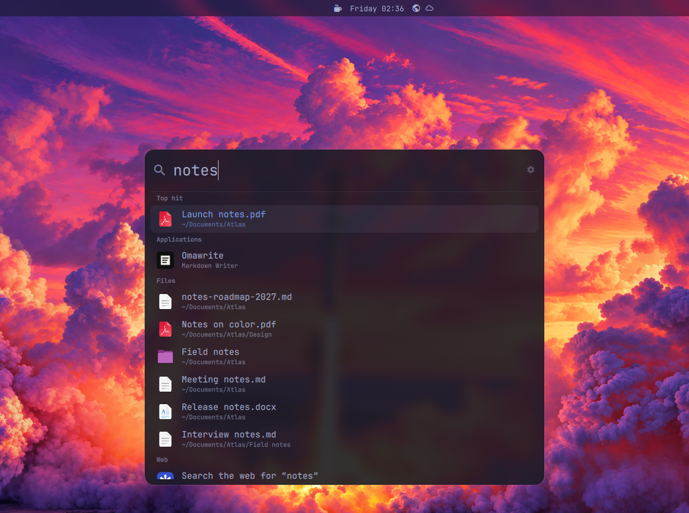
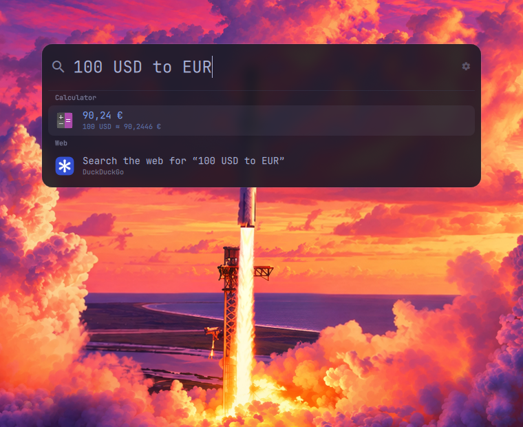
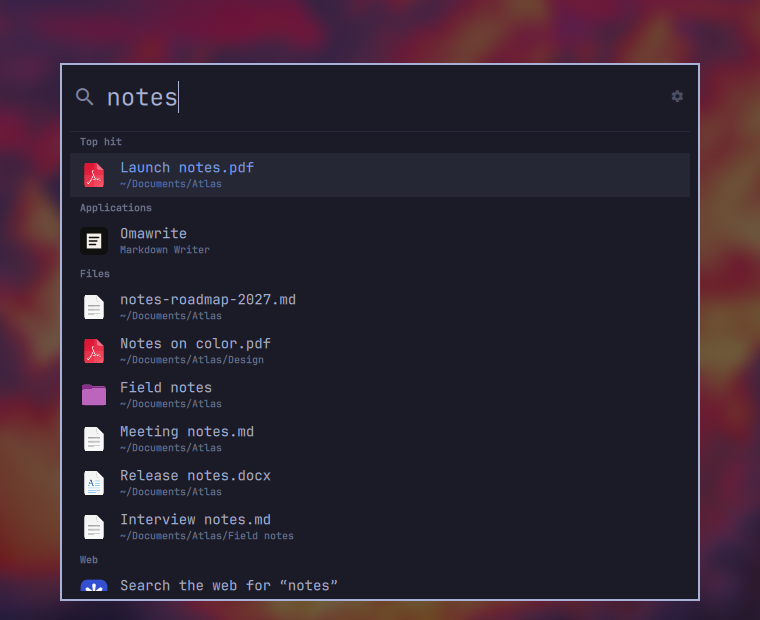
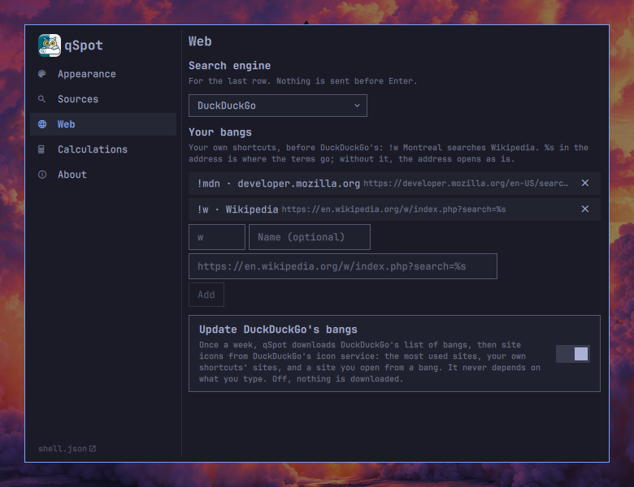

<p align="center">
  
</p>

<h1 align="center">qSpot</h1>

<p align="center">A Spotlight-style search for <a href="https://omarchy.org">Omarchy</a>: apps, files, calculations and the web in one field.</p>

<p align="center"><a href="README.fr.md">Version française</a></p>



**Coming from macOS?** qSpot is Spotlight: one key, type a few letters, Enter. From
Windows: the search in the Start menu, or PowerToys Run; from KDE: KRunner. It pairs
with [qDock](https://github.com/quebecstudio-mods/omarchy-qdock), the Dock,
[qExposé](https://github.com/quebecstudio-mods/omarchy-qexpose), Exposé and Mission Control,
and [qCenter](https://github.com/quebecstudio-mods/omarchy-qcenter), the Notification Center.

- **Apps**, ranked as in Omarchy's menu. An app that is already open comes
  forward instead of starting again; Shift+Enter opens a new window.
- **Files and folders** in your home folder, by name, as you type. qSpot keeps
  its own index, refreshed every half hour and when it opens, so a file saved
  a few minutes ago is there. Dependencies, caches and hidden folders stay out.
  With the field empty, the files you opened lately.
- **Open windows**, found by their title.
- **Calculations, units and currencies**: `12*7`, `5 km to mi`, `100 USD to EUR`,
  `15% of 240`. The result comes first; Enter copies it. With
  [qalc](https://qalculate.github.io) installed; without it, plain arithmetic.
- **The web.** An address opens as is. `!yt lofi` searches YouTube: DuckDuckGo's
  13,000 bangs are suggested as you type, and a bang followed by a space turns
  into a chip with the site's icon. Add your own shortcuts, and the last row
  searches the web with the engine of your choice.
- **It learns.** What you open for what you type comes first next time, as the
  top hit. Kept on your computer only.
- **Nothing you type leaves your computer before Enter.**
- **A settings window**, drawn with Omarchy's own controls, and a magnifier
  for the bar.
- **Four styles**, qDock's: Omarchy (your theme's menu), Cupertino (Spotlight,
  frosted glass), Redmond (like Windows' search) and Plasma (KRunner, under the
  bar). With qDock installed, qSpot follows qDock's style unless you set its own.
- **English and French**, following Omarchy's language. Calculations read
  French words too: `100 $ en €`, `15 % de 240`.

| Bangs | Calculations | Omarchy style |
| --- | --- | --- |
|  |  |  |

## Install

```bash
omarchy plugin add https://github.com/quebecstudio-mods/omarchy-qspot --enable
```

Omarchy first shows a security notice and asks you to confirm (*Clone and add
this plugin?*); add `--yes` to skip the question in a script.

The magnifier lands on the right of the bar: a click opens qSpot, a right
click its settings. For calculations with units and currencies, install qalc:

```bash
omarchy pkg add libqalculate
```

### A key

Spotlight's key is Command+Space, which Omarchy gives to its menu (Super+Space).
Alt+Space, as in Raycast and PowerToys Run, is where Omarchy toggles dictation
once a dictation app is installed; to give it to qSpot (push-to-talk on Right
Alt stays), add to `~/.config/hypr/bindings.lua`:

```lua
o.rebind("ALT + SPACE", "qSpot", "omarchy-shell -q quebecstudio.qspot toggle")
```

Or keep dictation there and take Super+Period, which is free:

```lua
o.bind("SUPER + PERIOD", "qSpot", "omarchy-shell -q quebecstudio.qspot toggle")
```

### Frosted glass

In the Cupertino, Redmond and Plasma styles, the window is translucent. For the
blur behind it, add this rule to `~/.config/hypr/hyprland.lua`:

```lua
hl.layer_rule({ match = { namespace = "^qspot$" }, blur = true, ignore_alpha = 0.2 })
```

## Remove

```bash
omarchy plugin remove quebecstudio.qspot
```

Omarchy turns qSpot off, takes its magnifier out of the bar and deletes its
folder. Then take out what you added by hand: the key in
`~/.config/hypr/bindings.lua` (with `o.rebind`, deleting the line gives Alt+Space
back to dictation), the blur rule in `~/.config/hypr/hyprland.lua` and, if you
copied it, `~/.local/share/applications/qspot-settings.desktop`. qSpot's
settings stay in its entry under `plugins` in `~/.config/omarchy/shell.json`,
and what it learned and cached in `~/.local/state/qspot` and `~/.cache/qspot`:
delete them too for a clean slate.

## Keys

| Key | What it does |
| --- | --- |
| Enter | Opens the selected result; an open app comes forward; a calculation is copied |
| Shift+Enter | A new window of an app that is already open |
| Ctrl+Enter | Shows a file in its folder |
| Ctrl+C | Copies a file's path (with no text selected in the field) |
| ↑ ↓, Ctrl+P / Ctrl+N | Move through the results |
| Tab | Takes the selected bang into the chip |
| Backspace | At the start of the field, removes the chip |
| Escape | Clears the field, then closes qSpot |

## Settings

qSpot has a settings window: click the gear at the end of the field,
right-click the magnifier in the bar, or open **qSpot Settings** from the app
launcher.



To find it in Omarchy's menu too, add this line to
`~/.config/omarchy/extensions/omarchy-menu.jsonc`:

```jsonc
"setup.qspot": {"icon":"󰍉","label":"qSpot Settings","aliases":["qspot","search","spotlight"],"action":"omarchy-shell -q quebecstudio.qspot settings"},
```

The launcher entry is in the plugin's `assets` folder:

```bash
cp ~/.config/omarchy/plugins/qspot/assets/qspot-settings.desktop ~/.local/share/applications/
cp ~/.config/omarchy/plugins/qspot/assets/logo.png ~/.local/share/icons/hicolor/256x256/apps/qspot.png
```

Every setting is kept in qSpot's entry under `plugins` in
`~/.config/omarchy/shell.json` (the **shell.json** link at the bottom of the
window opens it):

```json
{
  "id": "quebecstudio.qspot",
  "style": "cupertino",
  "searchEngine": "kagi",
  "webShortcuts": {
    "w": "https://en.wikipedia.org/w/index.php?search=%s",
    "local": { "name": "Local sites", "url": "http://%s.localhost", "home": "http://localhost" }
  }
}
```

| Setting | Values | Default |
| --- | --- | --- |
| `style` | `"omarchy"`, `"cupertino"`, `"redmond"`, `"plasma"` | qDock's style, else `"cupertino"` |
| `scrim` | `true` darkens the screen behind qSpot, `false` leaves it as it is | the style's: on for Omarchy and Redmond, off for Cupertino and Plasma |
| `apps` | `false` leaves apps out | `true` |
| `windows` | `false`: open apps start again rather than come forward, and windows are not searched | `true` |
| `files` | `false` leaves files out | `true` |
| `recentFiles` | `false`: nothing while the field is empty | `true` |
| `calculations` | `false` leaves calculations out | `true` |
| `web` | `false` leaves out addresses and the web search row; bangs still work | `true` |
| `searchEngine` | `"duckduckgo"`, `"google"`, `"bing"`, `"kagi"`, `"startpage"`, `"ecosia"`, `"brave"`, `"qwant"`, or an address with `%s` where the terms go | `"duckduckgo"` |
| `webShortcuts` | Your own bangs, before DuckDuckGo's: `{ "trigger": "address with %s" }`, or `{ "trigger": { "name", "url", "home" } }` (see below) | none |
| `learn` | `false`: qSpot does not remember what you pick | `true` |
| `bangUpdates` | `false`: no download of DuckDuckGo's bangs nor of site icons | `true` |
| `currencyUpdates` | `false`: qalc's exchange rates are not refreshed | `true` |

### Your own shortcuts

A shortcut's trigger is typed after `!`, in any case. `%s` in the address is
where the terms go; without it, the address opens as is. `!w Montreal` searches
Wikipedia; `!w` alone opens the site. When `%s` is part of the site itself
(`http://%s.localhost`), give a `home` for the bang typed alone. Shortcuts can
be added and removed in the settings window, under Web.

## Commands

```bash
omarchy-shell -q quebecstudio.qspot toggle
omarchy-shell -q quebecstudio.qspot open "text"   # opens with the field filled, for a dock or a start menu
omarchy-shell -q quebecstudio.qspot close
omarchy-shell -q quebecstudio.qspot settings      # the settings window
omarchy-shell -q quebecstudio.qspot settingsAt web   # on a section: appearance, sources, web, calc, about
omarchy-shell -q quebecstudio.qspot about
```

## Privacy

What you type stays on your computer until you press Enter, and then goes only
to the site you chose. qSpot itself connects to the network for three things,
none of which depends on what you type:

- **DuckDuckGo's list of bangs**, from `duckduckgo.com/bang.js`, once a week
  when qSpot opens.
- **Site icons**, from DuckDuckGo's icon service: those of the 300 most used
  bangs and of your own shortcuts' sites ahead of time, and that of any other
  site once you have opened it from a bang. `bangUpdates: false` turns both off.
- **Exchange rates**, fetched by qalc at most once a day when qSpot opens.
  `currencyUpdates: false` turns this off.

Your files' index (`~/.cache/qspot/home.db`) and what qSpot learns
(`~/.local/state/qspot/choices.json`) stay on your computer; **Forget my
choices**, under Sources, clears the latter.

## Good to know

- qSpot needs `plocate` and Python, both shipped with Omarchy. Until its own
  index is built, a few seconds after the first start, it reads the system's.
- Only your home folder is searched. Hidden files show up when what you type
  starts with a dot (`.env`); hidden folders, `node_modules`, `vendor`, build
  output and caches never do. `~/.config` is searched but ranks lower.
- The apps are Omarchy's launcher entries, hidden ones aside, with their icons.

## See also

- [qDock](https://github.com/quebecstudio-mods/omarchy-qdock), a Mac-style dock.
- [qExposé](https://github.com/quebecstudio-mods/omarchy-qexpose), Exposé and Alt+Tab with previews.
- [qCenter](https://github.com/quebecstudio-mods/omarchy-qcenter), a Mac-style notification center.
- [Changelog](CHANGELOG.md): what changed in each version.

## License

MIT © Québec Studio. Bangs are DuckDuckGo's; site icons come from DuckDuckGo's icon service.

macOS and Spotlight are trademarks of Apple Inc.; Windows and PowerToys are trademarks of Microsoft Corporation; KDE, Plasma and KRunner are trademarks of KDE e.V.; DuckDuckGo is a trademark of Duck Duck Go, Inc. This project is not affiliated with or endorsed by any of them.
